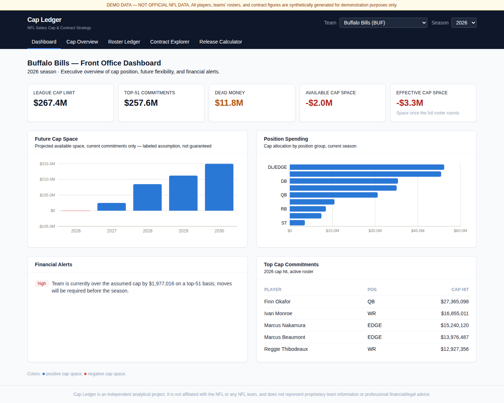
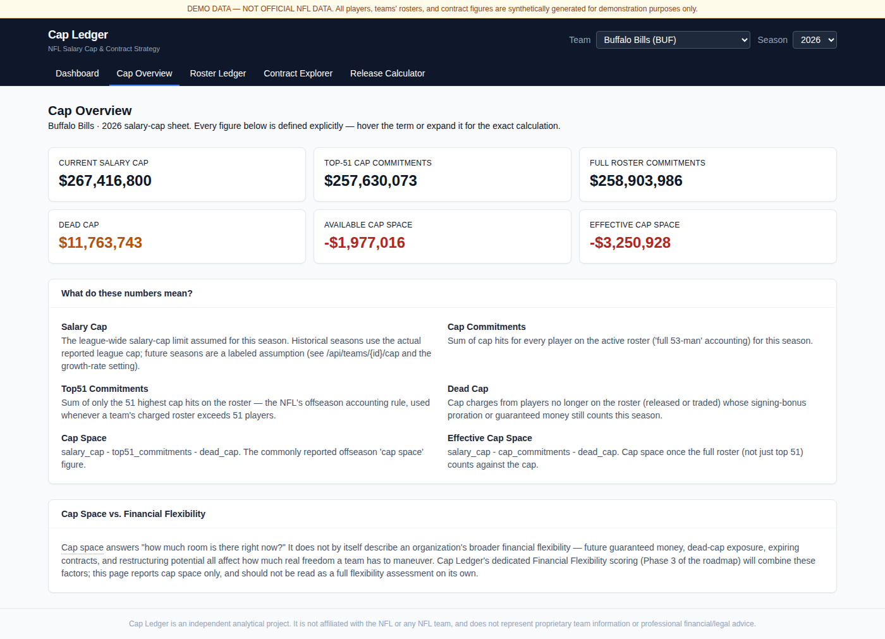
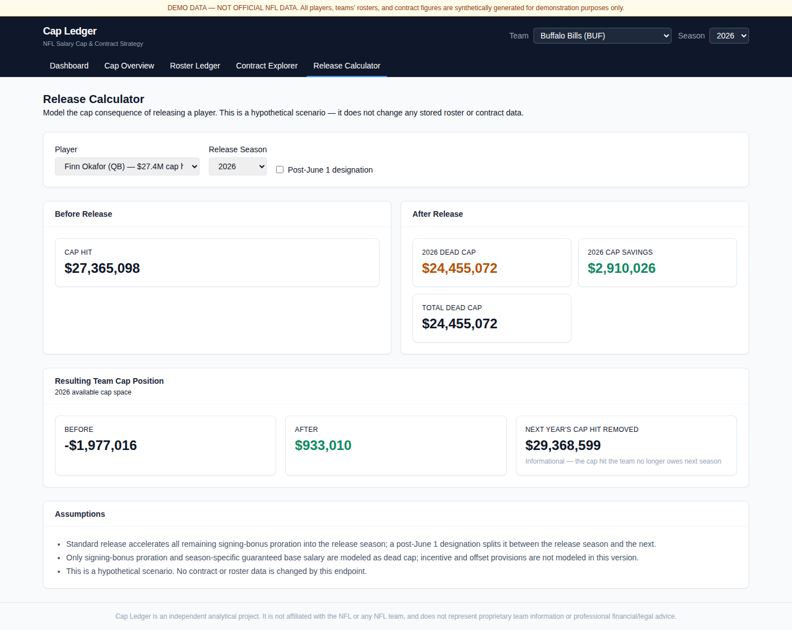

# Cap Ledger

**NFL Salary Cap & Contract Strategy Platform**

Cap Ledger is a portfolio, decision-support platform for NFL salary-cap and
contract analytics — the first component of a planned larger "NFL Front
Office Analytics Suite." This repository implements Cap Ledger's **Phase 1
MVP**: a working full-stack application covering the core cap/contract
workflow end to end.

> **DEMO DATA — NOT OFFICIAL NFL DATA.** Every player, roster, and contract
> figure in this repository is synthetically generated (see
> [`docs/data_sources.md`](docs/data_sources.md)). Team names/divisions are
> real, public franchise facts; nothing else is. Cap Ledger is an independent
> analytical project, not affiliated with the NFL, the NFLPA, or any team, and
> is not a substitute for professional financial or legal advice.

## Problem statement

Salary-cap management is not simply "how much cap space does the team have?"
The more useful question is **how much financial flexibility does the
organization actually have** — accounting for future commitments, dead-cap
exposure, guaranteed money, and the mechanisms (restructuring, extensions,
releases) available to create more room. Cap Ledger is built to turn
complicated salary-cap information into clear, explainable financial
decision support, and to keep **cap space** and **financial flexibility**
conceptually distinct rather than treating them as the same number.

## Product philosophy

- **Explainable over opaque.** The core cap engine is deterministic,
  rule-based arithmetic — not a model. Every number can be traced to a
  documented formula (`docs/cap_engine.md`).
- **Assumptions, always labeled.** Future league-cap figures, hypothetical
  contract terms, and analytical "decision points" are explicitly flagged as
  assumptions or model estimates — never presented as facts or team
  intentions.
- **Tradeoffs, not verdicts.** Cap Ledger shows what a release, restructure,
  or extension costs now and what it creates later. It does not declare a
  contract "good" or "bad," or a transaction automatically beneficial.

## Key features (Phase 1)

- **Front Office Dashboard** — current cap position, projected cap space
  through 2030, financial alerts, and position-group spending.
- **Cap Overview** — current cap, top-51 vs. full-roster commitments, dead
  cap, available vs. effective cap space, each with an explicit definition.
- **Roster Ledger** — sortable/filterable/searchable team financial table
  with per-player cap %, dead-cap-if-released, and contract status.
- **Contract Explorer** — league-wide contract search with side-by-side
  comparison of up to two contracts.
- **Player Contract Profile** — year-by-year financial timeline chart plus
  analytical decision points (expiration, large cap-hit years, potential
  release points, possible extension windows).
- **Release Calculator** — standard vs. post-June 1 release modeling, with
  before/after cap hit, dead cap, savings, and resulting team cap position.
- **Restructure Simulator** — models converting base salary into bonus
  proration, showing the current-year savings and exactly which future
  seasons absorb the cost.

## Screenshots

| Dashboard | Cap Overview |
|---|---|
|  |  |

| Player Contract Profile | Release Calculator |
|---|---|
|  |  |

Roster Ledger and Contract Explorer: see `docs/screenshots/`.

## Technology stack

**Backend:** Python, FastAPI, SQLAlchemy, Pydantic, PostgreSQL
**Analytics:** pandas, NumPy, SciPy (scikit-learn included for later phases —
see [`docs/ml_documentation.md`](docs/ml_documentation.md))
**Frontend:** React, TypeScript, Vite, Tailwind CSS, Recharts
**Infra:** Docker, Docker Compose

## Architecture

See [`docs/architecture.md`](docs/architecture.md) for the full breakdown.
In short: a React/TypeScript SPA talks to a FastAPI backend over a typed REST
API; the backend's deterministic `cap_engine.py` module is the single source
of truth for every cap-mechanics calculation, backed by an extensive
hand-verified unit-test suite.

## Database schema

Phase 1 implements six tables (see `backend/app/models/`):

```
teams ──< players ──< contracts ──< contract_years
  │                        │
  └──< team_cap            └── (roster status per season)
  └──< team_rosters
```

- **teams** — id, name, abbreviation, conference, division
- **players** — id, name, position, team_id, age, experience, status
- **contracts** — id, player_id, team_id, contract_start/end, total_value,
  annual_value, guaranteed_money, signing_bonus, current_salary/cap_hit,
  contract_status
- **contract_years** — id, contract_id, season, base_salary,
  signing_bonus_proration, roster_bonus, incentives, cap_hit, cash_value,
  dead_cap_value, guaranteed_base_salary
- **team_cap** — id, team_id, season, salary_cap, cap_commitments,
  top51_commitments, dead_cap, cap_space, effective_cap_space
- **team_rosters** — id, team_id, player_id, season, roster_status

Additional tables described in the full product brief (historical contracts,
contract scenarios, cap projections, team needs, position spending as a
persisted table) are reserved for later phases — see
[`docs/architecture.md`](docs/architecture.md#whats-implemented-vs-reserved-for-later-phases).

## Methodology

- [`docs/cap_engine.md`](docs/cap_engine.md) — signing-bonus proration, cap
  hits, dead cap, restructuring, team-cap rollups.
- [`docs/contract_methodology.md`](docs/contract_methodology.md) — how a
  contract's fields are structured.
- [`docs/release_methodology.md`](docs/release_methodology.md),
  [`docs/restructure_methodology.md`](docs/restructure_methodology.md) — the
  two implemented scenario simulators.
- [`docs/extension_methodology.md`](docs/extension_methodology.md),
  [`docs/financial_flexibility.md`](docs/financial_flexibility.md),
  [`docs/ml_documentation.md`](docs/ml_documentation.md) — not yet
  implemented; documented as reserved for later phases.
- [`docs/limitations.md`](docs/limitations.md) — every known simplification.

## Data sources

The shipped dataset is entirely synthetic. See
[`docs/data_sources.md`](docs/data_sources.md) for exactly what is
real (team names/divisions) vs. generated (everything else), and how to
regenerate it.

## Installation

### Option A: Docker Compose (recommended)

```bash
cp .env.example .env
docker compose up --build
```

- Backend API: http://localhost:8000 (interactive docs at `/docs`)
- Frontend: http://localhost:8080
- The backend container seeds the demo database automatically on startup.

> Note: this repository's automated build/test verification was performed
> against a locally installed PostgreSQL 16 and native Python/Node
> processes (no Docker daemon was available in that environment). The
> `docker-compose.yml` and Dockerfiles mirror those exact commands
> (`python -m app.seed.seed`, `uvicorn app.main:app`, `npm run build` behind
> nginx) but the containerized path itself has not been executed end-to-end.
> If anything doesn't come up cleanly, the native steps below are known-good.

### Option B: Native (no Docker)

**Backend**

```bash
cd backend
python3 -m venv venv && source venv/bin/activate
pip install -r requirements.txt
cp .env.example .env   # adjust DATABASE_URL if needed

# create a Postgres database matching DATABASE_URL, e.g.:
#   createuser capledger --pwprompt
#   createdb capledger -O capledger

python -m app.seed.seed        # loads synthetic demo data
uvicorn app.main:app --reload  # http://localhost:8000
```

**Frontend**

```bash
cd frontend
npm install
npm run dev   # http://localhost:5173, proxies /api to localhost:8000
```

## API documentation

FastAPI serves interactive OpenAPI docs at `/docs` (Swagger UI) and `/redoc`.
Key endpoints:

```
GET  /api/teams
GET  /api/teams/{id}
GET  /api/teams/{id}/cap?season=YYYY
GET  /api/teams/{id}/roster?season=YYYY
GET  /api/teams/{id}/spending?season=YYYY
GET  /api/teams/{id}/dashboard?season=YYYY
GET  /api/players?team_id=&position=&search=
GET  /api/players/{id}
GET  /api/contracts?team_id=&position=&search=&min_aav=&max_aav=
GET  /api/contracts/{id}
POST /api/contracts/{id}/release      { release_season, june1 }
POST /api/contracts/{id}/restructure  { restructure_season, amount_to_convert }
```

## Testing

```bash
cd backend
source venv/bin/activate
python -m pytest -q
```

48 tests across two suites:

- `tests/test_cap_engine.py` — hand-calculated scenarios for signing-bonus
  proration, cap hits, standard/post-June-1 dead cap, restructuring
  (including the "savings == future increase" invariant), and team-cap
  rollups (top-51 rule, negative cap space, etc.).
- `tests/test_api.py` — end-to-end API tests against a real Postgres
  database (teams, players, contracts, release/restructure endpoints,
  validation errors, 404s).

All financial calculations are covered by tests using known, independently
verifiable inputs and outputs — see `test_cap_engine.py` for the worked
examples (e.g., a 4-year/$20M-bonus contract released after two years should
show exactly $10M in accelerated dead cap under a standard release, split
$5M/$5M under a post-June-1 release).

## Example contract analysis

From the demo dataset (Buffalo Bills, 2026 season):

```
PLAYER: Finn Okafor (QB)
CURRENT CAP HIT (2026): $27,365,098
STANDARD RELEASE BEFORE 2026:
  Dead Cap:      $24,455,072
  Cap Savings:   $2,910,026
  Team cap space: -$1,977,016 → $933,010
```

Every figure above is produced by `cap_engine.calculate_dead_cap()` and can
be reproduced via `POST /api/contracts/{id}/release`.

## Limitations

See [`docs/limitations.md`](docs/limitations.md). In short: synthetic data,
simplified (but internally consistent) cap mechanics, no ML in this phase,
and several later-roadmap features (Financial Flexibility scoring, contract
efficiency/risk, historical comparisons, free-agent/rookie planning) not yet
built.

## Roadmap

Phase 1 (this repository) covers the MVP workflow: select a team → view cap
situation → view roster/contracts → select a player → model a release. Later
phases (see the project brief) add restructure/extension/trade tooling at
greater depth, a financial-flexibility score, position-spending analytics,
historical-contract comparisons, sensitivity analysis, and optional
ML-assisted contract value/risk models — each layered on top of the same
deterministic cap engine and schema built here.

## Independent-project disclaimer

Cap Ledger is an independent, personal/portfolio project. It is not
affiliated with, endorsed by, or connected to the National Football League,
the NFL Players Association, or any NFL team. It does not claim access to
proprietary team information and is not a substitute for professional
financial, salary-cap, or legal advice.
