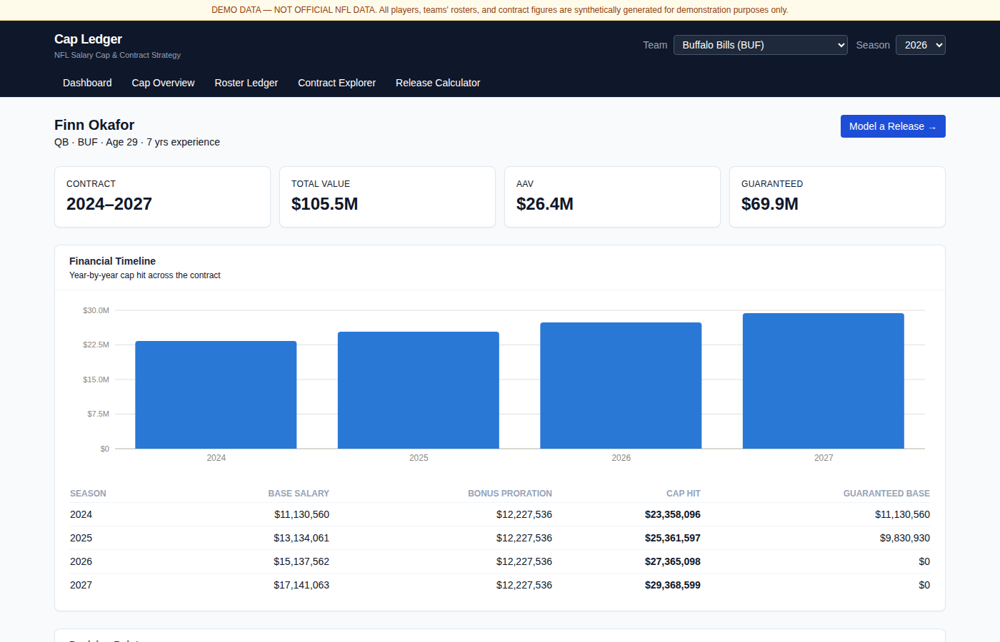
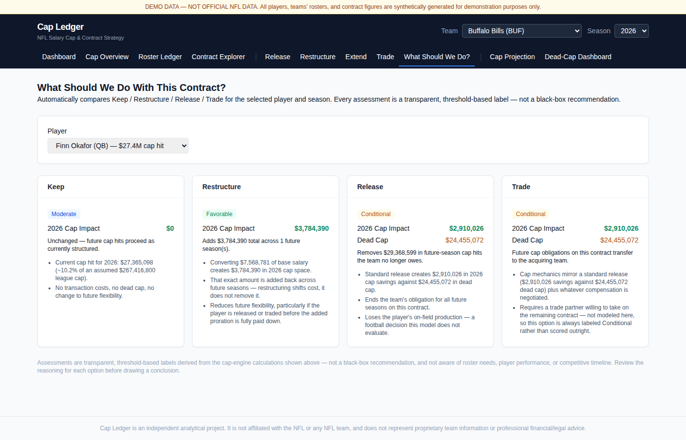
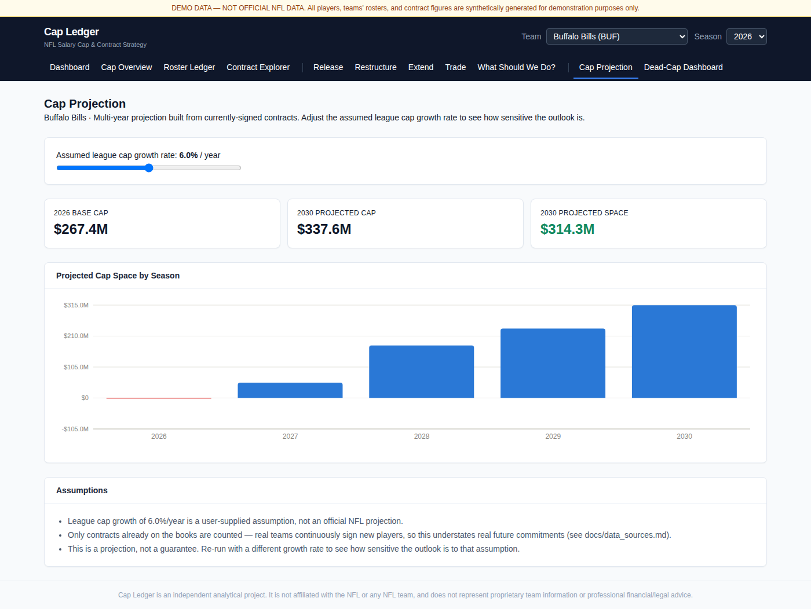
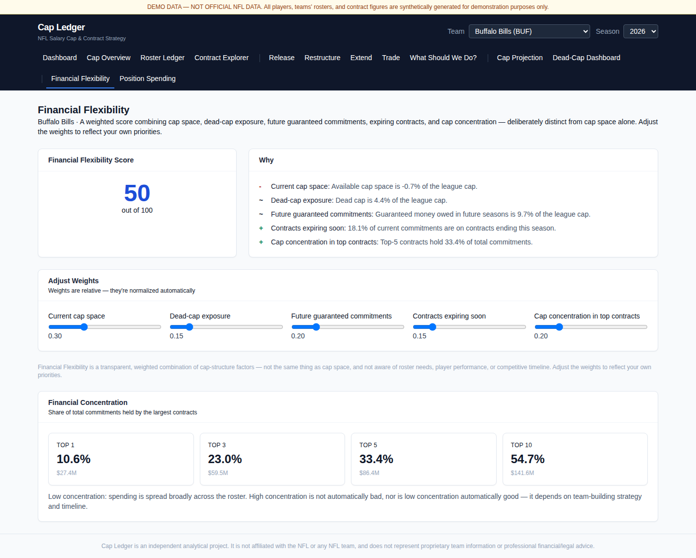
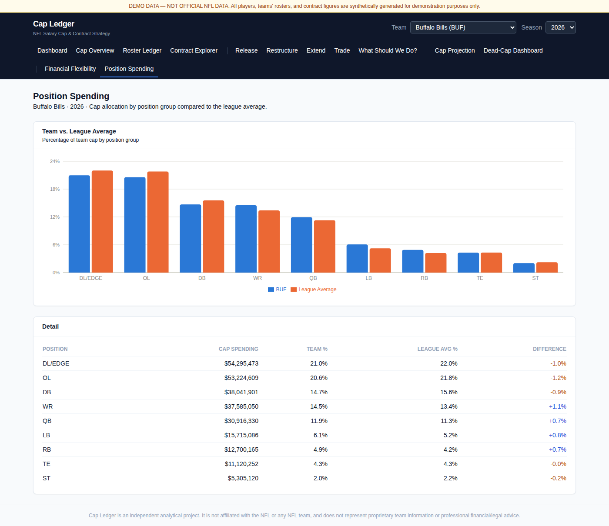

# Cap Ledger

**NFL Salary Cap & Contract Strategy Platform**

Cap Ledger is a portfolio, decision-support platform for NFL salary-cap and
contract analytics — the first component of a planned larger "NFL Front
Office Analytics Suite." This repository implements Cap Ledger's **Phase 1
(MVP)**, **Phase 2 (Contract Strategy)**, and **Phase 3 (Financial
Intelligence)**: a working full-stack application covering the core
cap/contract workflow end to end, a full suite of scenario simulators
(restructure, extension, trade, and an automatic Keep/Restructure/Release/
Trade comparison), adjustable-assumption cap projections, and a
Financial Flexibility score, contract-risk scoring, and market comparisons —
all deterministic and transparent, with no ML in the calculation path.

> **DEMO DATA — NOT OFFICIAL NFL DATA.** Every player, roster, and contract
> figure in this repository is synthetically generated (see
> [`docs/data_sources.md`](docs/data_sources.md)). Team names/divisions are
> real, public franchise facts; nothing else is. Cap Ledger is an independent
> analytical project, not affiliated with the NFL, the NFLPA, or any team, and
> is not a substitute for professional financial or legal advice.

## Problem statement

Salary-cap management is not simply "how much cap space does the team have?"
The more useful question is **how much financial flexibility does the
organization actually have** — accounting for future commitments, dead-cap
exposure, guaranteed money, and the mechanisms (restructuring, extensions,
releases) available to create more room. Cap Ledger is built to turn
complicated salary-cap information into clear, explainable financial
decision support, and to keep **cap space** and **financial flexibility**
conceptually distinct rather than treating them as the same number.

## Product philosophy

- **Explainable over opaque.** The core cap engine is deterministic,
  rule-based arithmetic — not a model. Every number can be traced to a
  documented formula (`docs/cap_engine.md`).
- **Assumptions, always labeled.** Future league-cap figures, hypothetical
  contract terms, and analytical "decision points" are explicitly flagged as
  assumptions or model estimates — never presented as facts or team
  intentions.
- **Tradeoffs, not verdicts.** Cap Ledger shows what a release, restructure,
  or extension costs now and what it creates later. It does not declare a
  contract "good" or "bad," or a transaction automatically beneficial.

## Key features

**Phase 1 — MVP**

- **Front Office Dashboard** — current cap position, projected cap space
  through 2030, financial alerts, and position-group spending.
- **Cap Overview** — current cap, top-51 vs. full-roster commitments, dead
  cap, available vs. effective cap space, each with an explicit definition.
- **Roster Ledger** — sortable/filterable/searchable team financial table
  with per-player cap %, dead-cap-if-released, and contract status.
- **Contract Explorer** — league-wide contract search with side-by-side
  comparison of up to two contracts.
- **Player Contract Profile** — year-by-year financial timeline chart plus
  analytical decision points (expiration, large cap-hit years, potential
  release points, possible extension windows).
- **Release Calculator** — standard vs. post-June 1 release modeling, with
  before/after cap hit, dead cap, savings, and resulting team cap position.

**Phase 2 — Contract Strategy**

- **Restructure Simulator** — converts base salary into bonus proration;
  shows the current-year savings and exactly which future seasons absorb the
  cost (the two always match exactly — enforced by a unit test).
- **Extension Simulator** — model a hypothetical extension with your own
  terms (years, total value, bonus, guarantees) and see the combined
  current-contract + extension timeline as a chart.
- **Trade Contract Calculator** — dead cap/savings for the trading team, and
  the cap hit an acquiring team would absorb (base salary only — no
  proration carries over).
- **"What Should We Do With This Contract?"** — automatically compares Keep
  / Restructure / Release / Trade side by side, each with a transparent,
  threshold-based assessment and its reasoning spelled out.
- **Cap Projection** — multi-year projection with a live-adjustable league
  cap growth-rate slider, so you can see how sensitive the outlook is to that
  assumption.
- **Dead-Cap Dashboard** — current dead cap by player, plus a multi-season
  timeline.
- **Scenario auditability** — every simulated release/restructure/extension/
  trade is persisted with its exact inputs, outputs, and cap-engine version
  (`contract_scenarios` table), so past "what-if" runs stay reproducible.

**Phase 3 — Financial Intelligence**

- **Financial Flexibility Score** — a transparent, weighted 0–100 score
  combining cap space, dead-cap exposure, future guaranteed commitments,
  expiring contracts, and cap concentration, with a live "Why" breakdown and
  adjustable weight sliders. Deliberately distinct from cap space alone.
- **Financial Concentration** — what share of the cap sits in the top
  1/3/5/10 contracts.
- **Contract Risk** — a transparent, non-ML structural risk score (age vs.
  position, contract length, guaranteed money, future cap concentration),
  shown on every Player Contract Profile.
- **Contract Value / Market Analysis** — compares a contract's AAV to other
  active contracts at the same position (and a similar age) in the dataset —
  an honest internal market comparison, since the demo dataset has no real
  performance data to compare against.
- **Position Spending vs. League Average** — a team's positional cap
  allocation charted against the league average, with the exact percentage
  differences.

## Screenshots

| Dashboard | Cap Overview |
|---|---|
|  |  |

| Player Contract Profile | Release Calculator |
|---|---|
|  |  |

| "What Should We Do?" Scenario Builder | Cap Projection |
|---|---|
|  |  |

| Financial Flexibility | Position Spending vs. League Average |
|---|---|
|  |  |

Roster Ledger, Contract Explorer, and the Extension Simulator: see `docs/screenshots/`.

## Technology stack

**Backend:** Python, FastAPI, SQLAlchemy, Pydantic, PostgreSQL
**Analytics:** pandas, NumPy, SciPy (scikit-learn included for later phases —
see [`docs/ml_documentation.md`](docs/ml_documentation.md))
**Frontend:** React, TypeScript, Vite, Tailwind CSS, Recharts
**Infra:** Docker, Docker Compose

## Architecture

See [`docs/architecture.md`](docs/architecture.md) for the full breakdown.
In short: a React/TypeScript SPA talks to a FastAPI backend over a typed REST
API; the backend's deterministic `cap_engine.py` module is the single source
of truth for every cap-mechanics calculation, backed by an extensive
hand-verified unit-test suite.

## Database schema

Eight tables (see `backend/app/models/`):

```
teams ──< players ──< contracts ──< contract_years
  │                        │              │
  │                        │              └──< (dead_cap_value per season)
  ├──< team_cap            └── contract_scenarios (audit log)
  ├──< team_rosters
  └──< cap_projections
```

- **teams** — id, name, abbreviation, conference, division
- **players** — id, name, position, team_id, age, experience, status
- **contracts** — id, player_id, team_id, contract_start/end, total_value,
  annual_value, guaranteed_money, signing_bonus, current_salary/cap_hit,
  contract_status
- **contract_years** — id, contract_id, season, base_salary,
  signing_bonus_proration, roster_bonus, incentives, cap_hit, cash_value,
  dead_cap_value, guaranteed_base_salary
- **team_cap** — id, team_id, season, salary_cap, cap_commitments,
  top51_commitments, dead_cap, cap_space, effective_cap_space
- **team_rosters** — id, team_id, player_id, season, roster_status
- **contract_scenarios** *(Phase 2)* — id, player_id, team_id, contract_id,
  scenario_type, model_version, assumptions (JSON), results (JSON),
  created_at — an audit row for every simulated release/restructure/
  extension/trade.
- **cap_projections** *(Phase 2)* — id, team_id, season, run_id,
  projected_cap, projected_commitments, projected_space, assumptions (JSON)
  — every Cap Projection run, grouped by `run_id`.

Additional tables described in the full product brief (historical contracts,
team needs, position spending as a persisted table) are reserved for later
phases — see
[`docs/architecture.md`](docs/architecture.md#whats-implemented-vs-reserved-for-later-phases).

## Methodology

- [`docs/cap_engine.md`](docs/cap_engine.md) — signing-bonus proration, cap
  hits, dead cap, restructuring, team-cap rollups.
- [`docs/contract_methodology.md`](docs/contract_methodology.md) — how a
  contract's fields are structured.
- [`docs/release_methodology.md`](docs/release_methodology.md),
  [`docs/restructure_methodology.md`](docs/restructure_methodology.md),
  [`docs/extension_methodology.md`](docs/extension_methodology.md),
  [`docs/trade_methodology.md`](docs/trade_methodology.md) — the four
  implemented scenario simulators.
- [`docs/financial_flexibility.md`](docs/financial_flexibility.md),
  [`docs/contract_risk_methodology.md`](docs/contract_risk_methodology.md),
  [`docs/contract_value_methodology.md`](docs/contract_value_methodology.md)
  — the Phase 3 scoring methodologies (all deterministic, no ML).
- [`docs/ml_documentation.md`](docs/ml_documentation.md) — not yet
  implemented; documented as reserved for Phase 5.
- [`docs/limitations.md`](docs/limitations.md) — every known simplification.

## Data sources

The shipped dataset is entirely synthetic. See
[`docs/data_sources.md`](docs/data_sources.md) for exactly what is
real (team names/divisions) vs. generated (everything else), and how to
regenerate it.

## Installation

### Option A: Docker Compose (recommended)

```bash
cp .env.example .env
docker compose up --build
```

- Backend API: http://localhost:8000 (interactive docs at `/docs`)
- Frontend: http://localhost:8080
- The backend container seeds the demo database automatically on startup.

> Note: this repository's automated build/test verification was performed
> against a locally installed PostgreSQL 16 and native Python/Node
> processes (no Docker daemon was available in that environment). The
> `docker-compose.yml` and Dockerfiles mirror those exact commands
> (`python -m app.seed.seed`, `uvicorn app.main:app`, `npm run build` behind
> nginx) but the containerized path itself has not been executed end-to-end.
> If anything doesn't come up cleanly, the native steps below are known-good.

### Option B: Native (no Docker)

**Backend**

```bash
cd backend
python3 -m venv venv && source venv/bin/activate
pip install -r requirements.txt
cp .env.example .env   # adjust DATABASE_URL if needed

# create a Postgres database matching DATABASE_URL, e.g.:
#   createuser capledger --pwprompt
#   createdb capledger -O capledger

python -m app.seed.seed        # loads synthetic demo data
uvicorn app.main:app --reload  # http://localhost:8000
```

**Frontend**

```bash
cd frontend
npm install
npm run dev   # http://localhost:5173, proxies /api to localhost:8000
```

## API documentation

FastAPI serves interactive OpenAPI docs at `/docs` (Swagger UI) and `/redoc`.
Key endpoints:

```
GET  /api/teams
GET  /api/teams/{id}
GET  /api/teams/{id}/cap?season=YYYY
GET  /api/teams/{id}/roster?season=YYYY
GET  /api/teams/{id}/spending?season=YYYY
GET  /api/teams/{id}/dashboard?season=YYYY
GET  /api/players?team_id=&position=&search=
GET  /api/players/{id}
GET  /api/contracts?team_id=&position=&search=&min_aav=&max_aav=
GET  /api/contracts/{id}
POST /api/contracts/{id}/release      { release_season, june1 }
POST /api/contracts/{id}/restructure  { restructure_season, amount_to_convert }
POST /api/contracts/{id}/trade        { trade_season }
POST /api/contracts/{id}/extend       { extension_start_season, new_length_years,
                                         new_total_value, new_signing_bonus, new_guaranteed_money }
GET  /api/contracts/{id}/scenarios?season=YYYY
POST /api/teams/{id}/projections      { growth_rate, seasons? }
GET  /api/teams/{id}/dead-cap?season=YYYY
GET  /api/analytics/financial-flexibility?team_id=&season=&w_cap_space=&w_dead_cap=...
GET  /api/analytics/concentration?team_id=&season=
GET  /api/analytics/contract-risk?contract_id=&season=
GET  /api/analytics/contract-value?contract_id=
GET  /api/analytics/position-spending-comparison?team_id=&season=
```

## Testing

```bash
cd backend
source venv/bin/activate
python -m pytest -q
```

98 tests across three suites:

- `tests/test_cap_engine.py` — hand-calculated scenarios for signing-bonus
  proration, cap hits, standard/post-June-1 dead cap, restructuring
  (including the "savings == future increase" invariant), trade impact
  (trading-team dead cap matches a standard release; acquiring-team hits
  exclude proration), contract extensions, and team-cap rollups (top-51
  rule, negative cap space, etc.).
- `tests/test_financial_intelligence.py` — financial concentration math,
  financial-flexibility scoring (favorable/unfavorable inputs, custom
  weights, score bounding), contract-risk categorization (including that a
  position's decline age actually changes the score), and market-comparison
  percentiles.
- `tests/test_api.py` — end-to-end API tests against a real Postgres
  database: teams, players, contracts, release/restructure/trade/extension
  endpoints, the scenario comparison and cap-projection endpoints
  (including that a higher growth rate yields more future space), the
  dead-cap dashboard, the Phase 3 analytics endpoints, validation errors,
  and 404s.

All financial calculations are covered by tests using known, independently
verifiable inputs and outputs — see `test_cap_engine.py` for the worked
examples (e.g., a 4-year/$20M-bonus contract released after two years should
show exactly $10M in accelerated dead cap under a standard release, split
$5M/$5M under a post-June-1 release).

## Example contract analysis

From the demo dataset (Buffalo Bills, 2026 season):

```
PLAYER: Finn Okafor (QB)
CURRENT CAP HIT (2026): $27,365,098
STANDARD RELEASE BEFORE 2026:
  Dead Cap:      $24,455,072
  Cap Savings:   $2,910,026
  Team cap space: -$1,977,016 → $933,010
```

Every figure above is produced by `cap_engine.calculate_dead_cap()` and can
be reproduced via `POST /api/contracts/{id}/release`.

## Limitations

See [`docs/limitations.md`](docs/limitations.md). In short: synthetic data,
simplified (but internally consistent) cap mechanics, no ML anywhere in this
version, and several later-roadmap features (historical contract
comparisons, sensitivity analysis, free-agent/rookie planning, competitive
timeline) not yet built. Contract Risk and Contract Value scoring are
explicitly scoped away from player performance/production data, which the
demo dataset does not have — see `docs/contract_risk_methodology.md` and
`docs/contract_value_methodology.md`.

## Roadmap

This repository covers Phase 1 (MVP: select a team → view cap situation →
view roster/contracts → select a player → model a release), Phase 2
(Contract Strategy: restructure, extension, and trade simulators; an
automatic Keep/Restructure/Release/Trade comparison; adjustable-assumption
cap projections; a dead-cap dashboard; and scenario auditability), and
Phase 3 (Financial Intelligence: a Financial Flexibility score, financial
concentration, contract risk, contract-vs-market value comparison, and
position spending vs. league average). Later phases (see the project brief)
add multi-year scenario sensitivity analysis, "what would change our mind"
framing, free-agent/rookie contract planning, historical-contract
comparisons, competitive-timeline classification, and optional ML-assisted
contract-value models — each layered on top of the same deterministic cap
engine and schema built here.

## Independent-project disclaimer

Cap Ledger is an independent, personal/portfolio project. It is not
affiliated with, endorsed by, or connected to the National Football League,
the NFL Players Association, or any NFL team. It does not claim access to
proprietary team information and is not a substitute for professional
financial, salary-cap, or legal advice.
